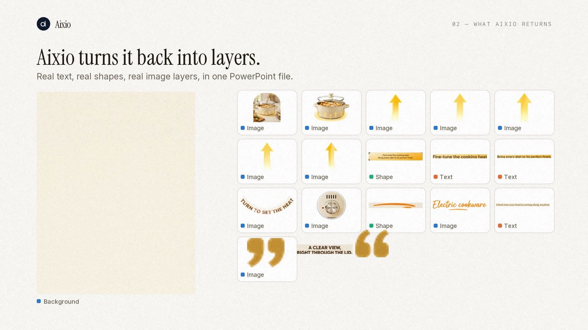
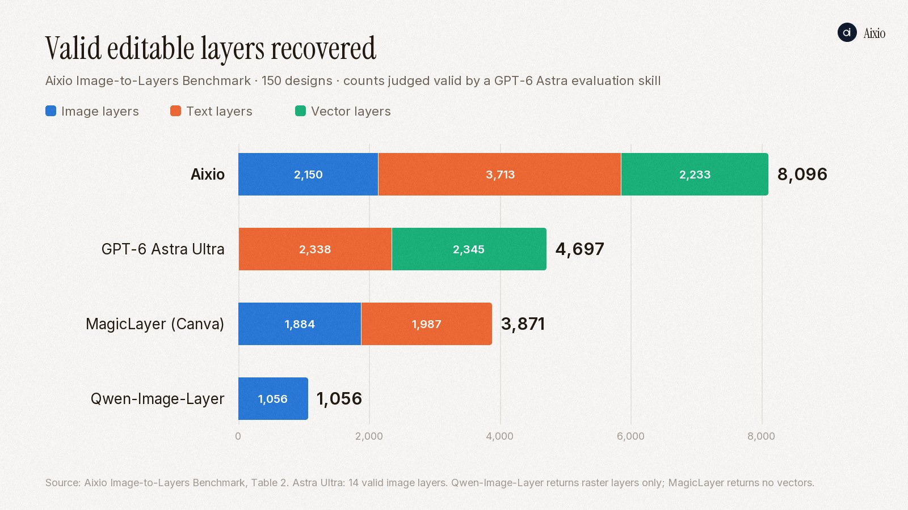
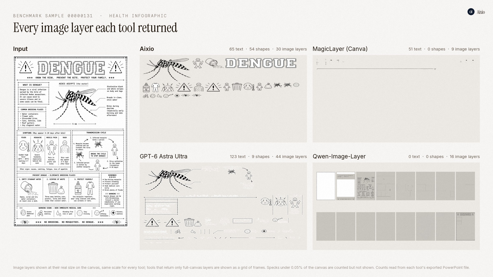
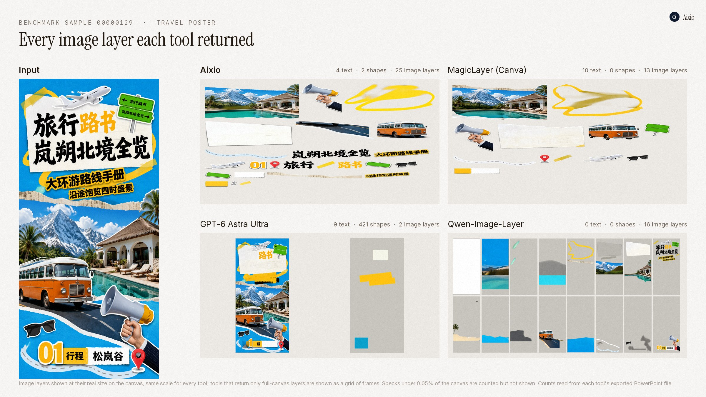
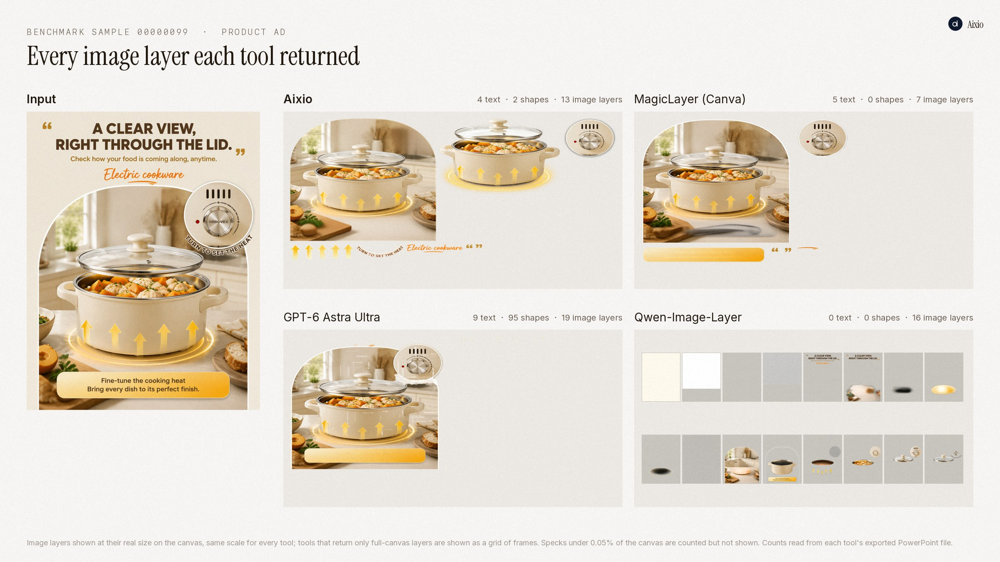
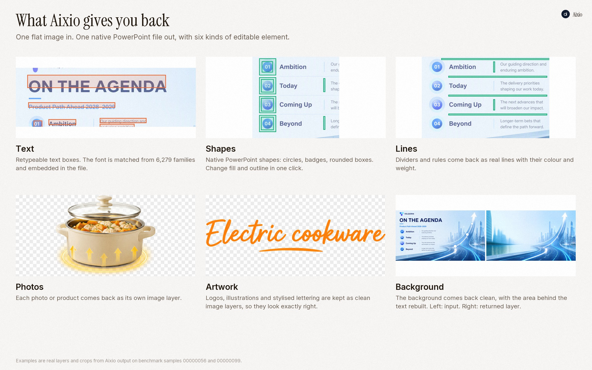

  <picture>
    <source media="(prefers-color-scheme: dark)" srcset="assets/logo-dark.png">
    
  </picture>

  # Aixio Layer v2 — Image-to-Layer AI Model

  **Flat design in. Editable PowerPoint out.**

  On a 150-design image-to-layer benchmark, Aixio Layer v2 recovered **8,096 valid editable layers**: **1.7×** the next best system and **2.1×** Canva Magic Layers, in about **47 seconds per image**.

  [Try in Aixio Studio](https://aixio.app/studio) · [Benchmark](#benchmark) · [Samples](#samples) · [What you get back](#what-you-get-back) · [Layer v1](https://github.com/aixioofficial/Aixio-layer-v1.0)

---

## What's new in v2

Layer v2 returns every part of a design in the form you would have built it in:

- **Editable text**: copy comes back as real text boxes you can retype, with the matched font embedded in the file.
- **Native shapes and lines**: badges, circles, rules and dividers come back as PowerPoint shapes you can recolour.
- **Clean image layers**: photos, products, illustrations and lettering each come back on their own layer.
- **A clean background**: the page background comes back as its own layer.
- **One native PowerPoint file**, in about 47 seconds per image.

## Benchmark

| Model | Valid image layers | Valid text layers | Valid vector layers | **Total valid layers** | Seconds per image |
| --- | ---: | ---: | ---: | ---: | ---: |
| **Aixio Layer v2** | **2,150** | **3,713** | 2,233 | **8,096** | **47** |
| GPT-6 Astra Ultra | 14 | 2,338 | **2,345** | 4,697 | 283 |
| Canva Magic Layers | 1,884 | 1,987 | 0 | 3,871 | – |
| Qwen-Image-Layer | 1,056 | 0 | 0 | 1,056 | 366 |

- **Most valid editable layers overall:** 8,096, against 4,697 for the next best system.
- **Most valid text and image layers** of any system tested.
- **Best reconstruction score** (LPIPS 0.1382), narrowly ahead of Canva Magic Layers (0.1414).
- GPT-6 Astra Ultra recovers slightly more valid vector layers (2,345 vs 2,233).

### What each system returns

| | Image layers | Editable text | Native shapes and lines |
| --- | :---: | :---: | :---: |
| **Aixio Layer v2** | **Yes** | **Yes** | **Yes** |
| GPT-6 Astra Ultra | Yes | Yes | Yes |
| Canva Magic Layers | Yes | Yes | No |
| Qwen-Image-Layer | Yes (16 full-canvas layers) | No | No |

### How we measured

All four systems received the same 150 designs: posters, slides, infographics,
social graphics, product pages and interfaces, both human-designed and
AI-generated. For each design we counted the editable elements that came back
usable:

- an **image layer** counts when it holds real content, isn't duplicated, and has no obvious artifacts;
- a **text layer** counts when it matches real text and isn't left baked into an image;
- a **vector layer** counts when it matches a real shape or line in appearance, colour and size.

Validity was judged by an evaluation skill built on GPT-6 Astra; GPT-6 Astra
Ultra is also one of the systems compared. Seconds per image is the reported
mean; Canva Magic Layers runs as a hosted product and was not timed. This is an
Aixio-reported benchmark.

## Samples

Each panel shows every image layer a system returned for the same design, laid
out at its real size on the canvas and at the same scale for every system.
Counts are read from each system's exported PowerPoint file.

## What you get back

## Where to use Aixio Layer v2

Layer v2 is available in **[Aixio Studio](https://aixio.app/studio)** through the
**Edit Layers** workflow. No installation or model download is required.

1. Open Aixio Studio and add a finished image (PNG, JPEG or WebP).
2. Choose **Edit Layers**.
3. Rewrite text, recolour shapes, move images, or download the PowerPoint file.

## News

- **2026-10** — Aixio Layer v2: editable text, native shapes and clean image layers in one PowerPoint file, with new benchmark results.
- **2026-08-04** — Aixio published the Layer v1 comparison across recognition, spatial reconstruction, font fidelity and native upsampling.
- **2026** — Aixio Layer v1 became available in Aixio Studio. See the [Layer v1 page](https://github.com/aixioofficial/Aixio-layer-v1.0).

## Rights and availability

Aixio Layer is an Aixio model delivered through Aixio Studio. This repository is a
product and results reference; it does not contain model weights, training code
or benchmark data. Unless a separate license is published, the model, service
and included Aixio assets should not be presented as open source or open
weights. Third-party names and marks belong to their respective owners and are
used only to identify the systems compared.

---

  <strong>Flat design in. Editable PowerPoint out.</strong>  
  <a href="https://aixio.app/studio">Try Aixio Layer v2 in Studio</a>

